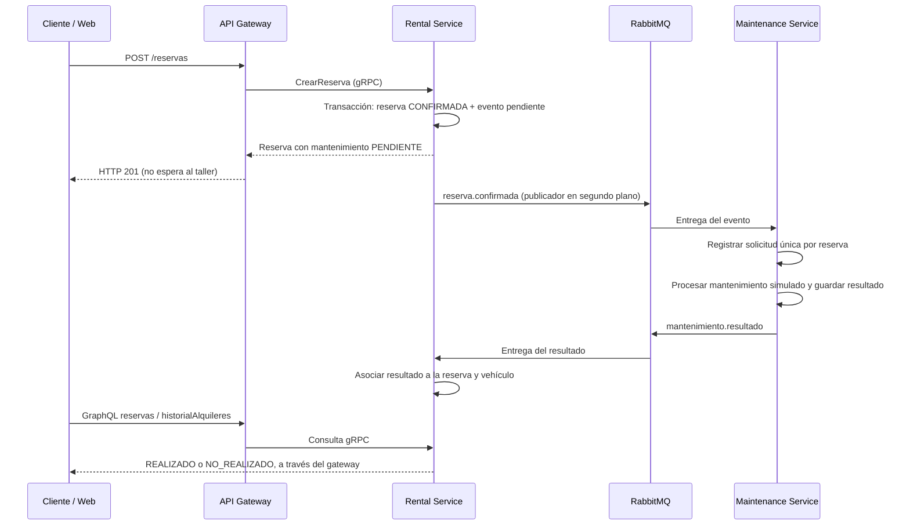
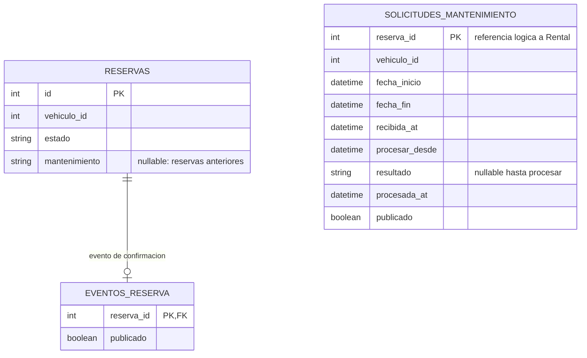
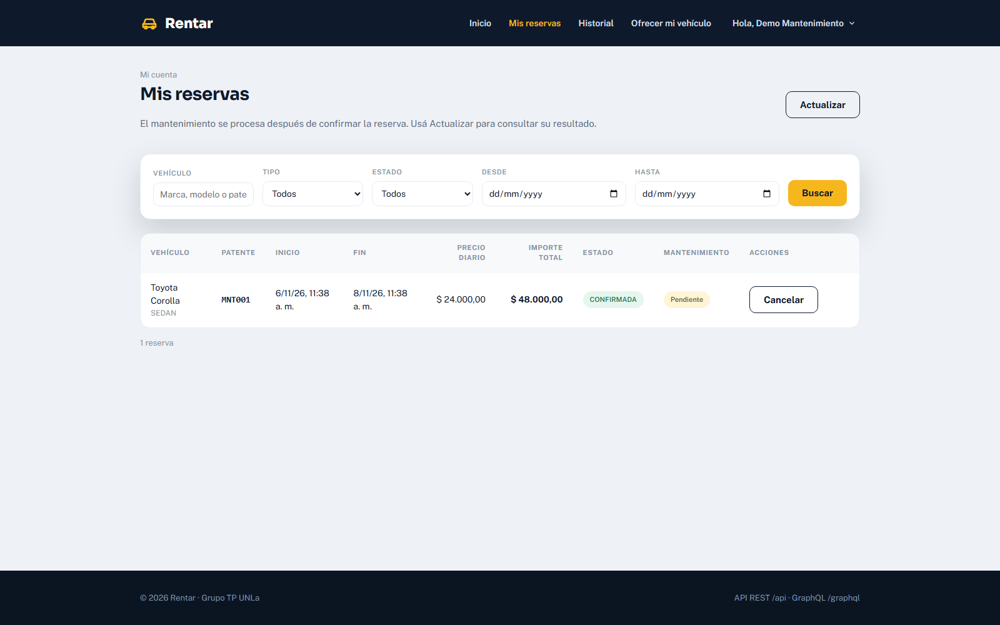
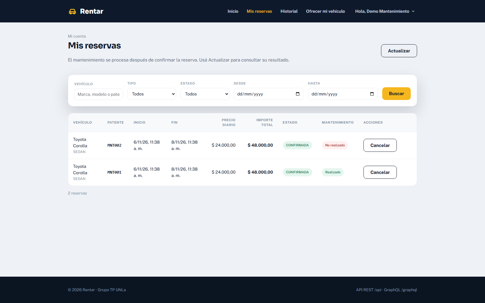
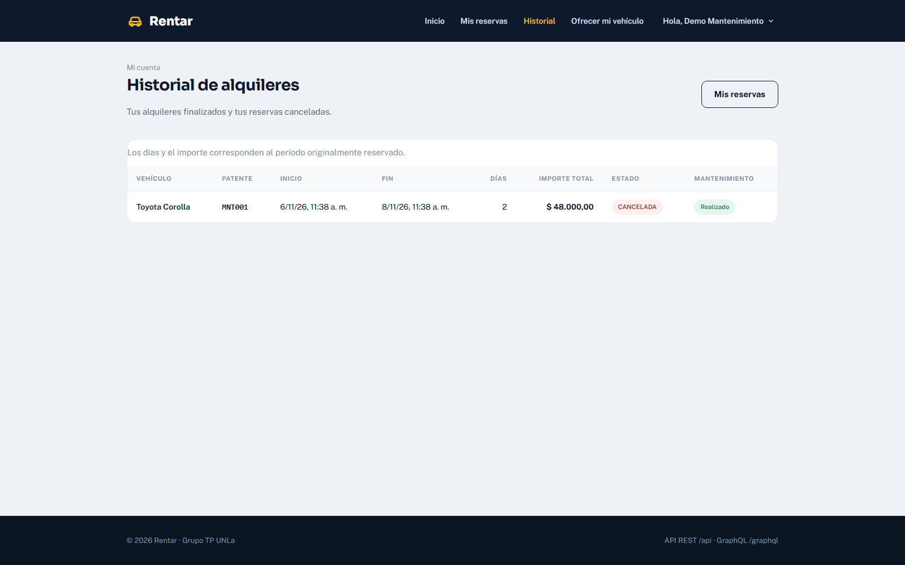

# Hito 3: mantenimiento preventivo asociado a una reserva

Implementación del apartado de la página 5 de `TP_RPC_KAFKA_RABBITMQ.pdf`.
Responsable de este punto en el grupo: Nicolas Pellegrino.

## Objetivo y recorrido

Una reserva se confirma inmediatamente. El mantenimiento del vehículo se solicita y
resuelve después, por eventos, sin bloquear la respuesta al cliente.



El estado `CONFIRMADA`, `CANCELADA` o `FINALIZADA` de la reserva es independiente
del mantenimiento. Un resultado `NO_REALIZADO` no cancela la reserva ni cambia el
estado operativo del vehículo. Cancelar una reserva tampoco elimina el resultado:
se conserva para su consulta en el historial. La consigna no pide cancelar el trabajo
del taller al cancelar una reserva, por lo que no se agrega ese flujo.

## Servicios y datos

- **Rental Service**, base `rentar_alquileres`: confirma la reserva con
  `mantenimiento = PENDIENTE` y registra su evento en `eventos_reserva`, en una
  misma transacción. Su publicador envía los eventos pendientes a RabbitMQ. Un
  consumidor independiente registra los resultados en `reservas.mantenimiento`.
- **Maintenance Service**, base propia `rentar_mantenimientos`: recibe la reserva
  y persiste `solicitudes_mantenimiento`. Un proceso periódico realiza la simulación
  del taller y publica el resultado guardado.
- **API Gateway** conserva REST, GraphQL y gRPC. No consulta las bases directamente
  ni llama al taller. El campo adicional `mantenimiento` viaja en el contrato gRPC
  `proto/rentar/alquileres/v1/rental.proto` (campo 11), la respuesta REST del alta y
  las consultas GraphQL de reservas e historial.
- **Frontend** muestra una columna Mantenimiento y un botón Actualizar en Reservas.
  No necesita mantener abierta la pantalla para que se procese el trabajo.



`solicitudes_mantenimiento` está en otra base: no existe una clave foránea entre
servicios. Se correlaciona por `reservaId` y se valida también `vehiculoId`.

Al iniciar, Rental agrega la columna de mantenimiento si falta. Maintenance crea
su base si no existe, incluso sobre un volumen de Hito 2 ya inicializado. No hace
falta borrar volúmenes ni perder datos. Las reservas anteriores muestran **Sin
solicitud**; no se generan mantenimientos retroactivos.

## Contratos de eventos

Exchange durable de tipo `topic`: **rentar.eventos**. Los cuerpos conservan los
nombres y campos del enunciado. Las fechas se normalizan a UTC (sufijo `Z`).

### reserva.confirmada

Productor: Rental Service. Cola durable: `maintenance_service.reserva.confirmada`.

```json
{
  "reservaId": 150,
  "vehiculoId": 15,
  "fechaInicio": "2026-11-10T10:00:00.000Z",
  "fechaFin": "2026-11-15T10:00:00.000Z"
}
```

### mantenimiento.resultado

Productor: Maintenance Service. Cola durable: `rental_service.mantenimiento.resultado`.

```json
{
  "reservaId": 150,
  "vehiculoId": 15,
  "resultado": "REALIZADO"
}
```

El resultado solo admite `REALIZADO` o `NO_REALIZADO`. `PENDIENTE` es el estado de
espera visible en la reserva, nunca un resultado publicado por el taller.

La identificación viaja en las propiedades AMQP del módulo compartido:
`message_id` UUID, `type` (nombre del evento), `timestamp`, `content_type` y
`correlation_id` (reservaId como texto). Cada intento de publicación tiene su
propio message_id; la idempotencia de negocio se basa en reservaId.

## Simulación del taller

La consigna no especifica un procedimiento mecánico. Se simula uno de manera
determinista, sin azar ni esperas en la llamada del cliente:

1. El consumidor registra la solicitud y confirma la entrega en RabbitMQ.
2. El taller toma las solicitudes pendientes cuyo `procesar_desde` ya llegó.
3. Si el inicio de la reserva ya pasó o el vehículo está configurado como sin
   recursos, guarda `NO_REALIZADO`. En otro caso guarda `REALIZADO`.
4. Publica el resultado y marca `publicado` solamente después de la confirmación
   del broker. Si el envío falla, lo reintenta conservando el resultado original.

Configuración opcional en el `.env` de la raíz, antes de recrear el worker:

```dotenv
MANTENIMIENTO_DEMORA_SEGUNDOS=2
MANTENIMIENTO_VEHICULOS_NO_REALIZADOS=15,20
```

La demora debe estar entre 0 y 3600 segundos. La lista de vehículos viene vacía
por defecto. Es una configuración de simulación del taller; no se expone como una
opción del usuario para alterar resultados.

## Entrega, reintentos y duplicados

- La reserva y el registro pendiente del evento se guardan juntos (**outbox**).
  No se invoca RabbitMQ dentro de `CrearReserva`, por lo que el alta funciona
  incluso si el broker está detenido.
- Los publicadores trabajan en segundo plano, en lotes de hasta 100, y reintentan
  cada dos segundos. Las colas son durables y los mensajes persistentes.
- La solicitud del taller tiene `reserva_id` como clave primaria: una entrega
  duplicada no genera otra solicitud. Se rechazan duplicados con datos diferentes.
- Si un servicio muere después de publicar pero antes de marcar el envío, puede
  publicar nuevamente al reiniciar. La entrega es **al menos una vez**, no
  exactamente una vez.
- El resultado en Rental se aplica solo a una reserva pendiente y al vehículo
  correspondiente. Repetir el mismo resultado no produce cambios; un resultado
  contradictorio o inválido se rechaza.
- Se mantiene el comportamiento común del proyecto: excepciones durante el
  consumo se envían a `rentar.eventos.dead` mediante el dead-letter exchange.
  No hay reintento automático de esos mensajes; requieren revisar la causa y
  republicarlos. Los fallos de envío de los publicadores sí tienen reintento.
- Para este TP, el trabajo mecánico es una actualización de base simulada. Un
  taller externo real necesitaría además una clave de idempotencia para sus
  efectos físicos o su propia API.

## Ejecutar y comprobar

Desde la raíz:

```bash
docker compose up -d --build
```

En otra terminal:

```bash
cd frontend
npm ci
npm run dev
```

Abrir http://localhost:5173. Crear una reserva como cliente, entrar en Mis reservas
y pulsar Actualizar para ver el resultado. El administrador puede consultarlo en
Reservas. Swagger: http://localhost:3000/api. RabbitMQ: http://localhost:55673.

Ejemplo de consulta autenticada en GraphQL:

```graphql
query {
  reservas {
    id
    vehiculo
    estado
    mantenimiento
  }
}
```

### Pruebas automáticas

```bash
docker compose run --rm --no-deps rental-service python -m pytest -q
docker compose run --rm --no-deps maintenance-service python -m pytest -q
```

Los tests usan SQLite temporal y un publicador inyectado, sin modificar las bases
de la aplicación. Cubren confirmación y outbox, rechazo sin evento, ambos
resultados, asociación con reserva/vehículo, duplicados, eventos inválidos,
recuperación tras fallo de publicación y cancelación sin pérdida del resultado.

Prueba integral con el stack y el frontend encendidos:

```bash
cd scripts/playwright
npm ci
npx playwright install chromium
node hito3-mantenimiento.cjs
```

Este script se debe ejecutar en desarrollo local. Crea un cliente ficticio
`mantenimiento.demo@example.test`, vehículos MNT001/MNT002 y reservas de prueba.
Conserva esos datos para demostración. Detiene temporalmente el taller y RabbitMQ;
restaura los servicios y la configuración al terminar, incluso si hay un error.
Verifica:

1. HTTP 201 y reserva CONFIRMADA con el taller detenido.
2. Resultado REALIZADO después de volver a arrancarlo.
3. HTTP 201 y reserva CONFIRMADA con el broker detenido.
4. Recuperación del evento y resultado NO_REALIZADO al arrancar RabbitMQ.
5. Entrega duplicada sin una segunda solicitud.
6. Cancelación e historial conservando el resultado.

### Capturas del flujo real

Validación local realizada el 30/10/2026: 23 tests de Rental (9 de mantenimiento),
9 de Maintenance, 15 unitarios del API Gateway y 18 de integración del Gateway
con PostgreSQL/gRPC aprobados (65 en total, más el recorrido integral de Playwright).
Gateway y frontend compilan;
lint sin errores (frontend conserva cuatro advertencias previas). La prueba
integral confirmó una reserva en 63 ms con el taller detenido y otra en 25 ms con
RabbitMQ detenido. Son mediciones de esta ejecución local, no una garantía de
rendimiento.

Al levantar el stack se corrigió también una referencia anterior en el Dockerfile
de Verification: ahora genera `proto/rentar/clientes/v1/customer.proto`, que es la
ruta que ya importaba su cliente gRPC. Sin ese ajuste el worker no podía arrancar.

Reserva confirmada sin esperar al mantenimiento:



Ambos resultados, con las reservas todavía confirmadas:



Resultado conservado en el historial de una reserva cancelada:



## Para explicar el punto en clase

El flujo principal es confirmar la reserva por REST y gRPC. En la misma
transacción se deja registrado el evento que debe publicarse, pero no se espera
ni a RabbitMQ ni al taller. Otro proceso publica ese evento; el taller lo recibe,
registra y procesa la solicitud en su propia base, y responde con otro evento.
Rental recibe el resultado y lo asocia a la reserva. La demostración más clara
es detener el taller, confirmar una reserva y volver a encenderlo: el cliente ya
tenía su reserva y el resultado llega después.
