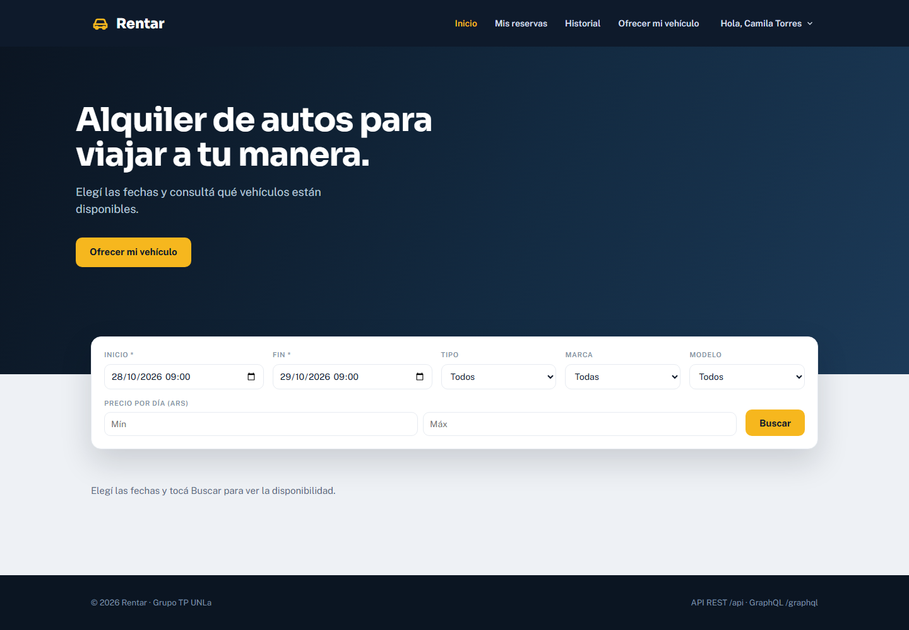
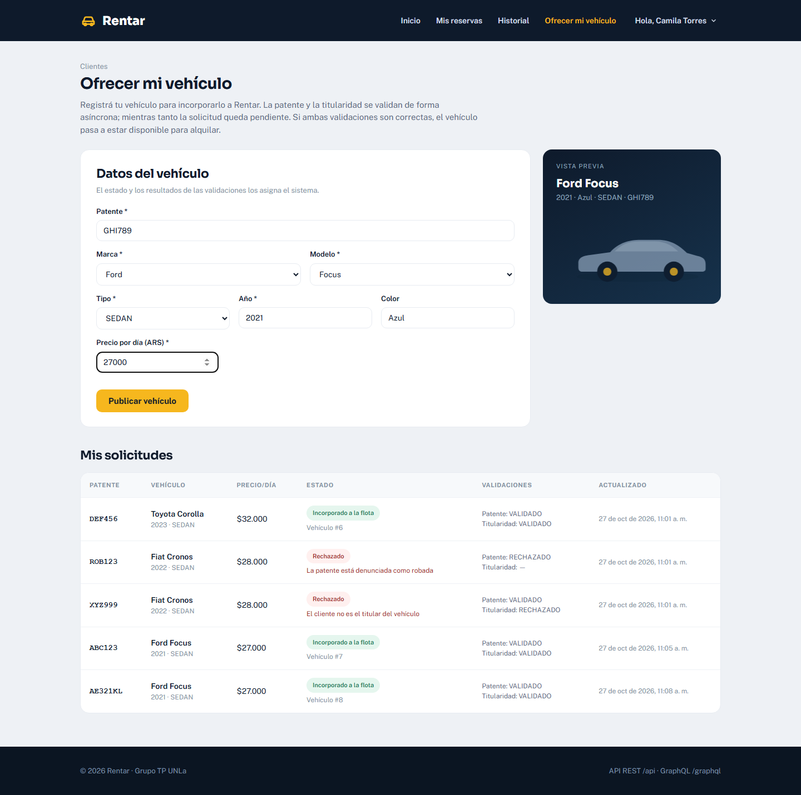
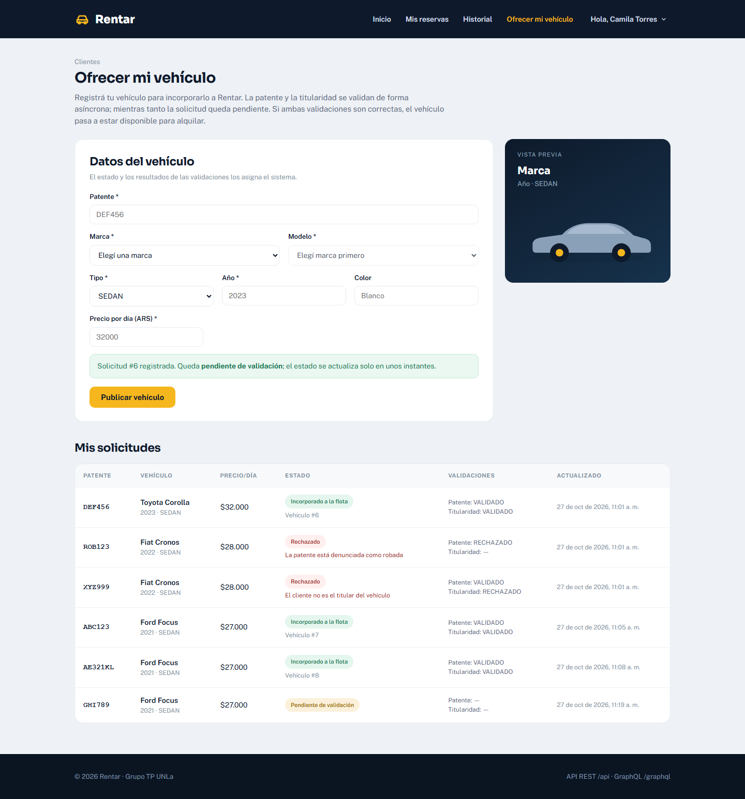
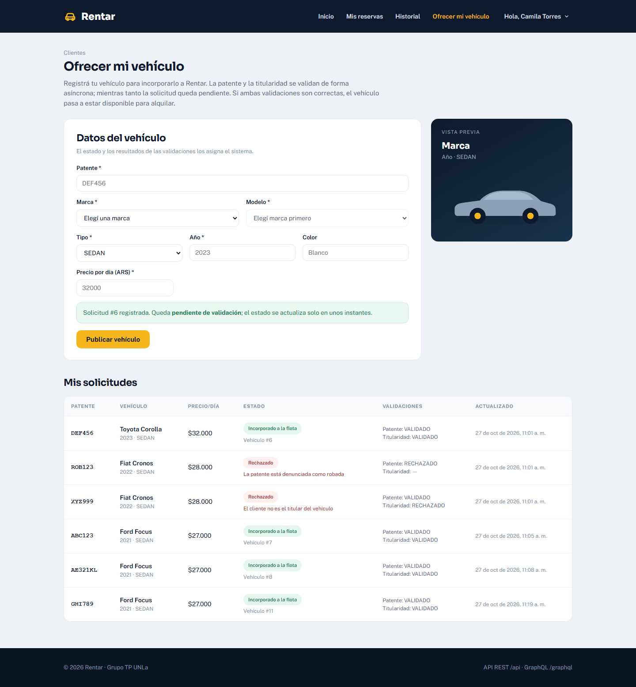
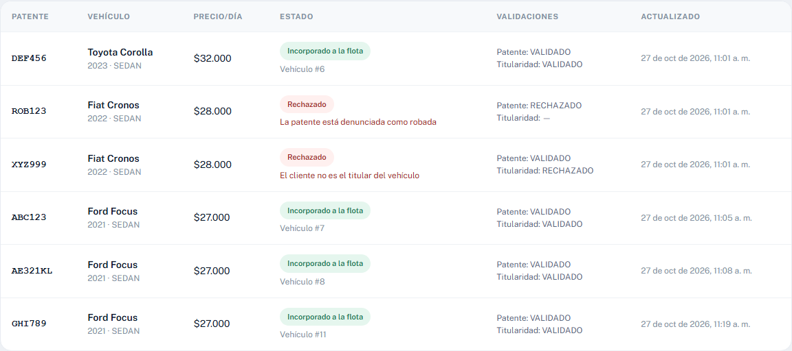
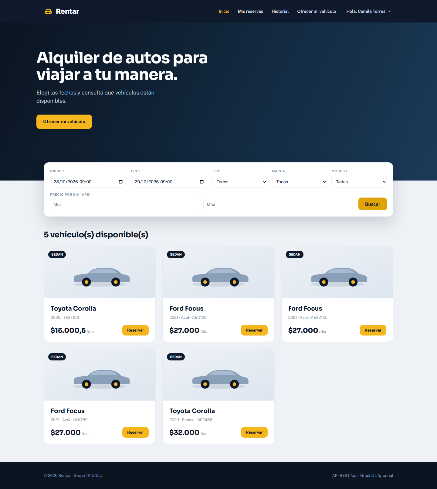
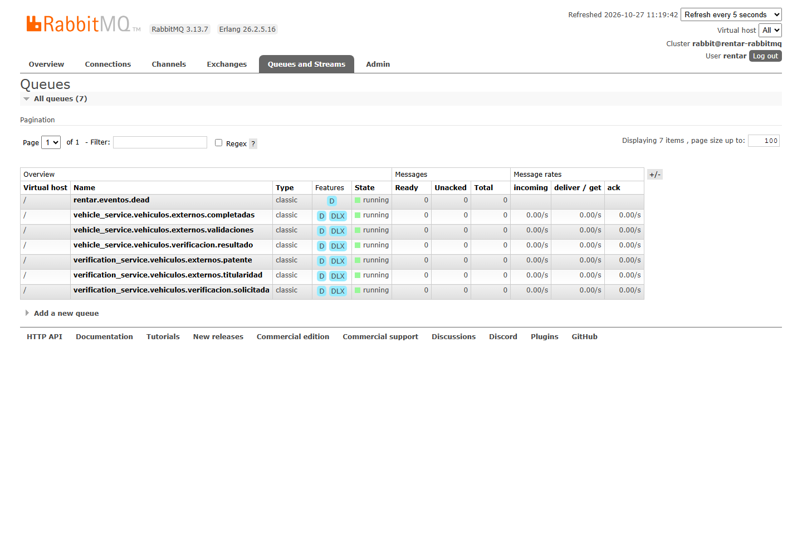

# Hito 3 — Incorporación de vehículos de propietarios externos

Este documento describe la segunda parte del Hito 3: un cliente registra un vehículo de su propiedad y el sistema lo incorpora a la flota después de validar, de forma asíncrona e independiente, la patente y la titularidad.

## Arquitectura

```text
Cliente (React)
   │ REST (JWT)
   ▼
API Gateway ──gRPC──► Vehicle Service ──publica──► RabbitMQ
                           ▲                          │
                           │                          ▼
                           │               Verification Service
                           │               ├─ valida patente (patentes_robadas)
                           │               ├─ valida titularidad (titularidades)
                           │               │      └──gRPC──► Customer Service
                           │               │                    (documento)
                           │               └─ publica los dos resultados
                           │
                           └──consume resultados, correlaciona y publica
                              vehiculos.externos.validacion.completada
                              └─ crea el vehículo en estado DISPONIBLE
```

- El **API Gateway** no accede a ninguna base: recibe el REST, toma el `clienteId` del JWT y delega por gRPC.
- El **Vehicle Service** es dueño de la solicitud externa, del correlador y de la incorporación final a `vehiculos`.
- El **Verification Service** mantiene el registro policial simulado y el registro externo de titularidad. Sus dos validadores son consumidores independientes.
- El **Customer Service** entrega el `documento` del cliente por gRPC para compararlo con el titular de la patente.
- **RabbitMQ** transporta los eventos. El exchange es `rentar.eventos` (topic), con colas durables y dead-letter exchange.

## Eventos

| Evento | Productor | Consumidor | Payload |
|---|---|---|---|
| `vehiculos.externos.registrados` | Vehicle Service, al registrar la solicitud | Verification Service (dos colas independientes) | `{ "vehiculoExternoId": 50, "clienteId": 89, "patente": "DEF456" }` |
| `vehiculos.externos.validacion.patente` | Verification Service | Vehicle Service (correlador) | `{ "vehiculoExternoId": 50, "patente": "DEF456", "resultado": "VALIDADO" }` |
| `vehiculos.externos.validacion.titularidad` | Verification Service | Vehicle Service (correlador) | `{ "vehiculoExternoId": 50, "clienteId": 89, "documento": "30123456", "patente": "DEF456", "resultado": "VALIDADO" }` |
| `vehiculos.externos.validacion.completada` | Vehicle Service (correlador) | Vehicle Service (incorporador) | `{ "vehiculoExternoId": 50 }` |

`resultado` es `VALIDADO` o `RECHAZADO`. Los eventos se publican con `message_id`, `type`, `timestamp`, `content_type` y `correlation_id` (el `vehiculoExternoId`) en las propiedades AMQP.

## Modelo de datos

### `rentar_vehiculos.vehiculos_externos`

| Campo | Descripción |
|---|---|
| `id` | Identificador de la solicitud |
| `cliente_id` | Cliente del token que registró el vehículo |
| `patente` | Normalizada en mayúsculas, sin espacios ni guiones; única |
| `marca`, `modelo`, `anio`, `color`, `tipo`, `precio_diario` | Datos del vehículo |
| `estado` | `PENDIENTE`, `APROBADO` o `RECHAZADO` |
| `validacion_patente` | `VALIDADO`, `RECHAZADO` o nulo |
| `validacion_titularidad` | `VALIDADO`, `RECHAZADO` o nulo |
| `vehiculo_id` | Id del vehículo creado cuando se aprueba |
| `motivo_rechazo` | Explicación para la pantalla del cliente |
| `completada_publicada` | Evita publicar dos veces el evento de incorporación |
| `created_at`, `updated_at` | Auditoría |

### `rentar_verificaciones`

- `patentes_robadas`: registro policial simulado. `ROB123`, `AC452KL`, `AD903RT` y `KZT481` figuran como robadas.
- `titularidades`: registro externo simulado. `DEF456`, `ABC123`, `AE321KL`, `GHI789` y `JKL012` pertenecen al documento `30123456`; `XYZ999` pertenece a `99999999`, para probar el rechazo.

### `rentar_vehiculos.vehiculos`

No cambia el esquema. Cuando la solicitud se aprueba se inserta un vehículo con:

- `estado = DISPONIBLE`
- `activo = true`
- `verificacion = VALIDADO`

`PENDIENTE` y `RECHAZADO` son estados de la solicitud, no estados operativos del vehículo. Los estados operativos siguen siendo `DISPONIBLE`, `RESERVADO` y `EN_ALQUILER`.

## Flujo

1. El cliente completa el formulario en `/publicar-vehiculo` y el Gateway llama `RegistrarVehiculoExterno` por gRPC.
2. El Vehicle Service valida los datos y que la patente no exista en la flota ni en otra solicitud, guarda la solicitud en `PENDIENTE` y publica `vehiculos.externos.registrados`.
3. El Verification Service consume el evento en dos colas independientes:
   - **Patente:** consulta `patentes_robadas` y publica `validacion.patente`.
   - **Titularidad:** obtiene el documento del cliente por gRPC desde el Customer Service, lo compara con `titularidades` y publica `validacion.titularidad`.
4. El Vehicle Service correlaciona los dos resultados por `vehiculoExternoId`:
   - Si alguno es `RECHAZADO`, la solicitud pasa a `RECHAZADO` y no se incorpora.
   - Si ambos son `VALIDADO`, publica `validacion.completada`.
5. El incorporador consume `validacion.completada`, crea el vehículo en `vehiculos` y pasa la solicitud a `APROBADO`.
6. El vehículo queda disponible para las operaciones habituales de Rentar.

### Idempotencia

- Los resultados se aplican solo si la solicitud sigue `PENDIENTE` y el campo de esa validación está vacío.
- La incorporación se ignora si la solicitud ya está `APROBADA` o si la patente ya existe en `vehiculos`.
- La patente es única en `vehiculos_externos` y en `vehiculos`.
- Los eventos repetidos de RabbitMQ no duplican el vehículo ni la solicitud.

## API

### `POST /vehiculos/externos`

Requiere rol `CLIENTE`. El `clienteId` sale del JWT; si el cuerpo intenta enviarlo, se ignora.

```json
{
  "patente": "ABC123",
  "marca": "Ford",
  "modelo": "Focus",
  "anio": 2021,
  "color": "Azul",
  "tipo": "SEDAN",
  "precioDiario": 27000
}
```

Respuesta `201`:

```json
{
  "id": 4,
  "clienteId": 13,
  "patente": "ABC123",
  "estado": "PENDIENTE",
  "validacionPatente": null,
  "validacionTitularidad": null,
  "vehiculoId": null,
  "motivoRechazo": null
}
```

### `GET /vehiculos/externos/mios`

Requiere rol `CLIENTE`. Devuelve solo las solicitudes del cliente del token, con el estado y el resultado de cada validación.

## Pruebas

### Servicios Python

```text
Vehicle Service:       42 passed
Verification Service:  17 passed
```

Casos cubiertos:

- Alta externa: queda `PENDIENTE`, publica el evento y normaliza la patente.
- Patente duplicada en la flota o en otra solicitud.
- Broker caído: el alta no se revierte y queda `PENDIENTE`.
- Validación de patente y de titularidad, con documentos coincidentes y distintos.
- Correlación: una validación rechazada no incorpora; dos válidas publican `completada` una sola vez.
- Idempotencia de resultados y de la incorporación.
- Incorporación con patente ya existente.
- Listado por cliente y búsqueda inexistente.

### API Gateway

```text
Test Suites: 2 passed
Tests:       15 passed
E2E de permisos: 6 passed
```

Incluye la unidad de `VehiculosExternosService` y los permisos REST del controlador. Los otros servicios mantienen sus pruebas: Customer 20, Rental 14.

### Playwright

El script `scripts/playwright/hito3-screenshots.cjs` hace la prueba completa contra el stack:

1. Inicia sesión como cliente.
2. Detiene el Verification Service.
3. Registra un vehículo y captura el estado `PENDIENTE`.
4. Reinicia el Verification Service y espera la incorporación asíncrona.
5. Verifica que el vehículo aparezca en la disponibilidad.
6. Captura la tabla de solicitudes y las colas de RabbitMQ.

Capturas generadas en `docs/capturas/`:

- `04-h3-home-cta.png`: acceso desde la Home.
- `05-h3-formulario.png`: formulario y solicitudes anteriores.
- `06-h3-pendiente.png`: solicitud pendiente mientras el worker está detenido.
- `07-h3-aprobado.png`: incorporación asíncrona completada.
- `08-h3-rechazos.png`: rechazos por patente robada y por titularidad.
- `09-h3-disponibilidad.png`: vehículos externos incorporados en la disponibilidad.
- `10-h3-rabbitmq.png`: colas y topología en la consola de RabbitMQ.















## Cómo ejecutar la prueba

Con el stack y el frontend levantados:

```bash
cd scripts/playwright
npm install
npx playwright install chromium
node hito3-screenshots.cjs
```

Variables opcionales:

- `RENTAR_WEB_URL` (por defecto `http://127.0.0.1:5173`)
- `RENTAR_RABBIT_URL` (por defecto `http://localhost:55673`)
- `RENTAR_CLIENTE_EMAIL` y `RENTAR_CLIENTE_PASSWORD`
- `RENTAR_PATENTE` (por defecto `ABC123`; usar `AE321KL`, `GHI789` o `JKL012` si ya se registró, o agregar otra patente a `TITULARIDADES`)

Si el cliente configurado no existe, el script lo crea con el administrador y el documento `30123456`, y usa la contraseña temporal `Usuario{id}*`. Si el cliente ya existe pero las credenciales no coinciden, hay que pasar `RENTAR_CLIENTE_EMAIL` y `RENTAR_CLIENTE_PASSWORD`.

## Decisiones y límites

- **Titularidad por gRPC:** el documento se obtiene del Customer Service en el momento de validar, en lugar de copiarlo en el evento `registrados`. Así el payload del enunciado queda exacto y se sigue usando gRPC dentro del flujo asíncrono.
- **Dos consumidores independientes:** cada validación tiene su cola y su hilo. Si una validación falla o se cae, la otra puede seguir procesando.
- **Sin reintento automático del alta si el broker está caído:** la solicitud queda `PENDIENTE` y el alta no se revierte. El evento se puede reintentar manualmente; el diseño no implementa un outbox transaccional.
- **Sin reintento después de un rechazo:** la patente queda asociada a la solicitud rechazada. Para volver a intentar habría que agregar una operación de descarte o una clave única parcial por estado.
- **Mantenimiento preventivo:** es la tercera parte del Hito 3 y no está incluida en este cambio.

## Integrantes y tareas

Completar antes de la entrega con los nombres del grupo y la tarea de cada integrante.
