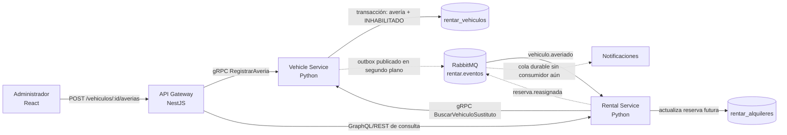
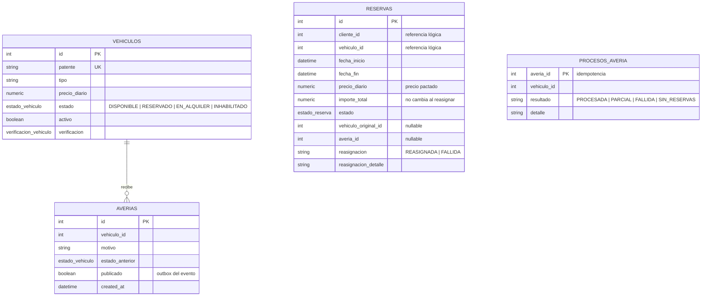
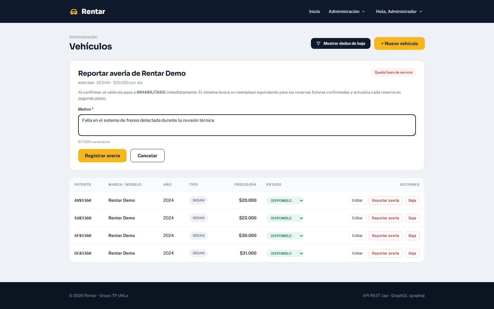
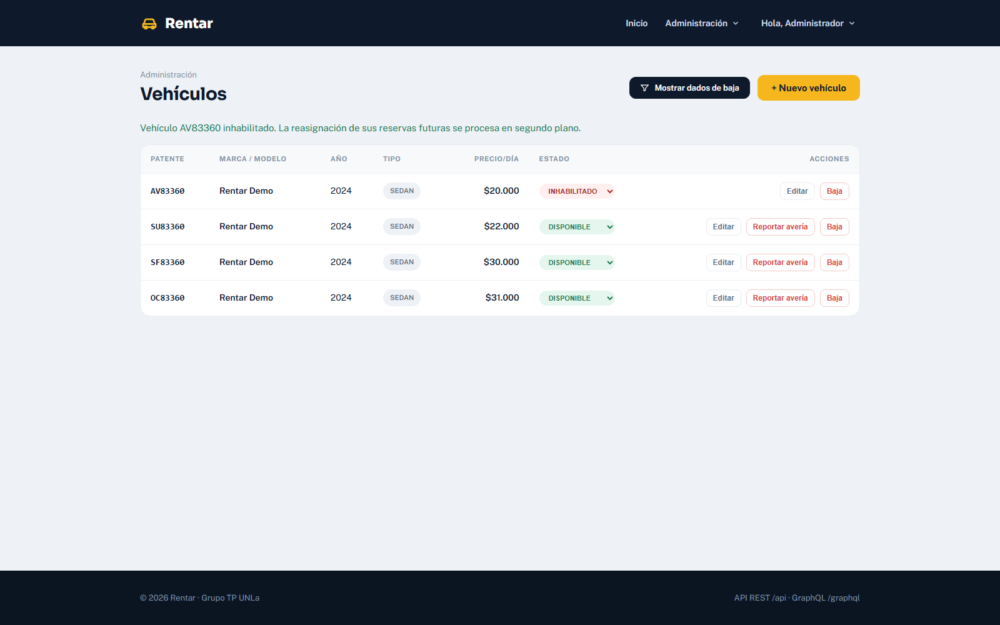
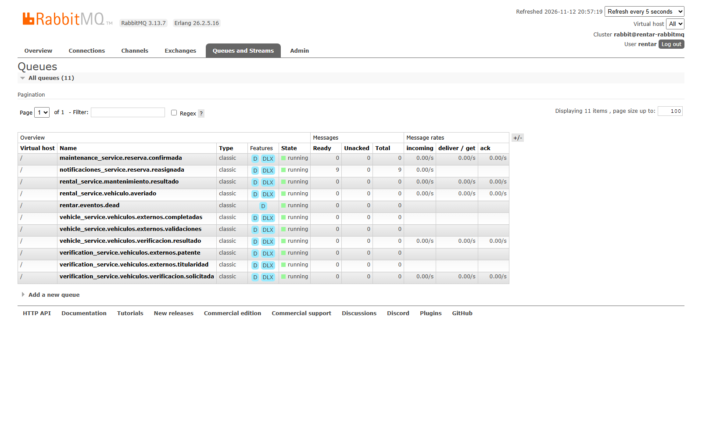
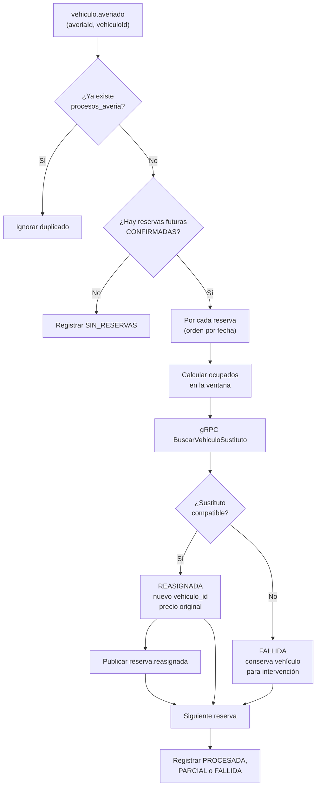
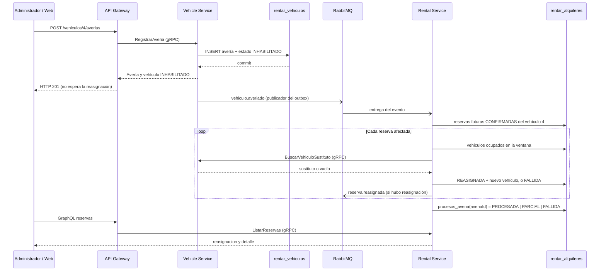
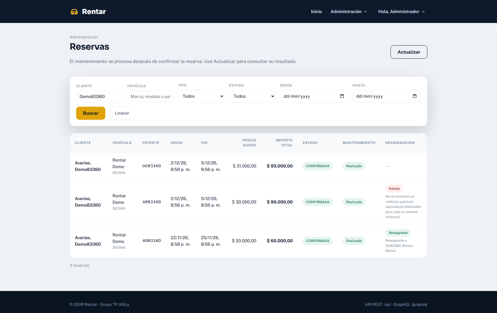

# Recuperatorio: averías y reasignación automática de reservas

Implementación del recuperatorio del TP de Sistemas Distribuidos. El escenario
tiene tres pasos encadenados:

1. Un administrador reporta que un vehículo sufrió una avería.
2. La novedad se comunica de forma asíncrona al resto del sistema.
3. El Rental Service reasigna automáticamente las reservas futuras confirmadas a
   un vehículo sustituto equivalente o deja la reserva marcada como fallida para
   que un operador intervenga.

La solución se apoya en las mismas piezas de los hitos anteriores: **API Gateway
en NestJS**, **servicios gRPC en Python**, **RabbitMQ** para eventos y
**PostgreSQL** con una base por servicio.

## Resumen de la solución

| Punto | Mecanismo | Servicio responsable |
|---|---|---|
| 1. Reportar la avería | REST del Gateway → gRPC `RegistrarAveria` | Vehicle Service |
| 2. Notificar la avería | Evento `vehiculo.averiado` por RabbitMQ | Vehicle Service (outbox) |
| 3. Reasignar reservas | Consumo del evento → gRPC `BuscarVehiculoSustituto` → actualización de reservas | Rental Service |

La respuesta HTTP del reporte **no espera** a RabbitMQ ni a la reasignación. En
la misma transacción se guarda la avería y se deja el vehículo `INHABILITADO`;
un publicador en segundo plano se encarga del evento. El administrador recibe la
confirmación de que el vehículo quedó fuera de servicio y el resto ocurre
después.

## Decisiones de diseño

### Por qué gRPC para el punto 1

El reporte es una operación de negocio síncrona: el administrador necesita saber
si la avería quedó registrada y si el vehículo pasó a `INHABILITADO`. Por eso la
operación viaja por el camino que ya usan las escrituras del proyecto:

```text
Navegador → REST (Gateway) → gRPC (Vehicle Service) → PostgreSQL
```

El Gateway expone `POST /vehiculos/:id/averias` porque es la fachada pública que
consumen el frontend, Swagger y los tests. Internamente no accede a la base: llama
al RPC `RegistrarAveria` del Vehicle Service, que es el dueño del vehículo y de
sus averías. Así se mantienen JWT, roles, validaciones HTTP y el contrato gRPC
existente, sin agregar un segundo mecanismo de escritura.

El punto 2 sí es asíncrono y por eso usa RabbitMQ: al Vehicle Service no le
interesa quién reacciona a la avería ni cuánto tarda. El evento desacopla el
reporte de la reasignación y permite sumar consumidores sin tocar al productor.

### Por qué el vehículo pasa a `INHABILITADO`

Se agregó el estado operativo `INHABILITADO` en lugar de reutilizar `activo =
false`:

- El vehículo sigue existiendo en la flota y conserva su historial.
- No se ofrece en disponibilidad ni se puede reservar.
- Cuando se repara, el administrador puede volver a ponerlo `DISPONIBLE` desde
  el cambio de estado; no hace falta darlo de alta otra vez.
- `activo = false` se reserva para la baja lógica, que es una decisión distinta.

El estado anterior se guarda en `averias.estado_anterior` para trazabilidad.

### Por qué la reasignación vive en Rental

Las reservas pertenecen al Rental Service. El Vehicle Service no conoce clientes
ni reservas, y no debería consultar la base de otro servicio. Por eso el flujo es:

1. Vehicle notifica `vehiculo.averiado`.
2. Rental busca las reservas afectadas en su propia base.
3. Para cada una, Rental pide al Vehicle Service un sustituto compatible por
   gRPC.
4. Rental actualiza sus reservas y publica `reserva.reasignada`.

La comunicación entre servicios sigue siendo por contrato (gRPC y eventos), sin
acceso cruzado a bases.

## Arquitectura



El Gateway no accede a ninguna base. RabbitMQ usa el exchange durable de tipo
`topic` **rentar.eventos**, ya creado en el Hito 3.

## Modelo de datos



`averias` está en `rentar_vehiculos`; `reservas` y `procesos_averia` están en
`rentar_alquileres`. No hay claves foráneas entre bases: las referencias son
lógicas y se validan por los contratos.

### Migraciones compatibles

Al arrancar, cada servicio agrega lo que falta sin borrar datos:

- Vehicle Service: valor `INHABILITADO` al enum `estado_vehiculo` y tabla
  `averias` (`CREATE TABLE IF NOT EXISTS` vía SQLAlchemy).
- Rental Service: columnas `vehiculo_original_id`, `averia_id`, `reasignacion` y
  `reasignacion_detalle` en `reservas`, y tabla `procesos_averia`.
- Las reservas anteriores quedan con esas columnas en `NULL`; no se reasignan
  retroactivamente.

## Punto 1: reporte de la avería

### Contrato gRPC

Definido en [`proto/rentar/vehiculos/v1/vehicle.proto`](../proto/rentar/vehiculos/v1/vehicle.proto):

```proto
rpc RegistrarAveria(RegistrarAveriaRequest) returns (RegistrarAveriaResponse);

message RegistrarAveriaRequest {
  int32 vehiculo_id = 1;
  string motivo = 2;
}

message RegistrarAveriaResponse {
  Averia averia = 1;
  Vehiculo vehiculo = 2;  // ya INHABILITADO
}

message Averia {
  int32 id = 1;
  int32 vehiculo_id = 2;
  string motivo = 3;
  EstadoVehiculo estado_anterior = 4;
  string created_at = 5;
  string updated_at = 6;
}
```

Validaciones del RPC:

- El motivo no puede estar vacío (`INVALID_ARGUMENT`).
- El vehículo debe existir (`NOT_FOUND`).
- No puede estar dado de baja, robado (`verificacion = ROBADO`) ni ya
  `INHABILITADO` (`FAILED_PRECONDITION`).

El servicio habilita reflexión gRPC, así que el RPC se puede probar directo desde
el host (sin pasar por el Gateway):

```bash
grpcurl -plaintext \
  -d '{"vehiculoId": 4, "motivo": "Falla en el sistema de frenos"}' \
  localhost:55051 rentar.vehiculos.v1.VehicleService/RegistrarAveria
```

### Endpoint REST del Gateway

```http
POST /vehiculos/{id}/averias
Authorization: Bearer <token de administrador>
Content-Type: application/json

{
  "motivo": "Falla en el sistema de frenos"
}
```

Respuesta `201 Created`:

```json
{
  "averia": {
    "id": 7,
    "vehiculoId": 4,
    "motivo": "Falla en el sistema de frenos",
    "estadoAnterior": "DISPONIBLE",
    "createdAt": "2026-11-12T15:00:00.000Z",
    "updatedAt": "2026-11-12T15:00:00.000Z"
  },
  "vehiculo": {
    "id": 4,
    "patente": "AV65411",
    "estado": "INHABILITADO",
    "activo": true
  }
}
```

La operación requiere rol `ADMIN`: sin token responde `401` y con otro rol `403`.
El Gateway traduce los códigos gRPC a HTTP como en el resto del proyecto.

### Transacción y efecto

En una sola transacción el Vehicle Service:

1. Inserta la avería con el motivo y el estado anterior.
2. Cambia `vehiculos.estado` a `INHABILITADO`.
3. Confirma.

No se llama a RabbitMQ dentro de la transacción. Si el broker está caído, el
reporte igual funciona y el vehículo queda fuera de servicio. El evento se envía
después, desde el outbox.

En la interfaz, el administrador entra en **Administración → Vehículos**, pulsa
**Reportar avería** en la fila del vehículo, escribe el motivo y confirma. La
tabla refresca el estado a `INHABILITADO` y deja de mostrar el botón de reporte
para esa unidad.





## Punto 2: evento `vehiculo.averiado`

### Topología

| Elemento | Valor |
|---|---|
| Exchange | `rentar.eventos` (topic, durable) |
| Routing key | `vehiculo.averiado` |
| Cola del consumidor | `rental_service.vehiculo.averiado` (durable) |
| Dead-letter exchange | `rentar.eventos.dlx` → `rentar.eventos.dead` |
| Cola de notificaciones | `notificaciones_service.reserva.reasignada` (durable, sin consumidor en esta entrega) |



La cola `rental_service.vehiculo.averiado` es la que consume Rental; por eso su
profundidad vuelve a cero después de procesar. La cola de notificaciones aparece
con mensajes listos porque en esta entrega no tiene consumidor: sirve como
evidencia de que el evento de confirmación se publica y queda disponible.

### Payload

```json
{
  "averiaId": 7,
  "vehiculoId": 4,
  "patente": "AV65411",
  "motivo": "Falla en el sistema de frenos",
  "tipo": "SEDAN",
  "precioDiario": "20000",
  "fecha": "2026-11-12T15:00:00.000Z"
}
```

Las fechas se normalizan a UTC con sufijo `Z` y el dinero viaja como string
decimal, igual que en los contratos gRPC. La identificación del mensaje va en las
propiedades AMQP del módulo compartido: `message_id` (UUID), `type`
(`vehiculo.averiado`), `timestamp`, `content_type` y `correlation_id` (el
`averiaId` como texto).

### Outbox y reintentos

La tabla `averias` tiene la columna `publicado`. El flujo es:

1. La transacción guarda la avería con `publicado = false`.
2. El hilo publicador del Vehicle Service (`app/averias.py`) toma hasta 100
   pendientes cada dos segundos.
3. Publica con confirmación del broker y recién entonces marca `publicado =
   true`.
4. Si el broker falla, el registro queda pendiente y se reintenta.

Esto da una entrega **al menos una vez**: si el proceso se corta entre publicar y
marcar, el evento puede repetirse al reiniciar. El consumidor es idempotente por
`averiaId`.

El evento se declara en el módulo compartido [`messaging/__init__.py`](../messaging/__init__.py),
que todos los servicios copian en su imagen. Las colas son durables y los
mensajes persistentes.

## Punto 3: reasignación automática

### Alcance

El consumidor de Rental procesa únicamente reservas que cumplen todo esto:

- `estado = CONFIRMADA`.
- Pertenecen al vehículo averiado (`vehiculo_id`).
- `fecha_inicio > ahora()`: todavía no comenzaron.

Las reservas canceladas, finalizadas o en curso no se tocan. Tampoco se modifican
reservas de otros vehículos.

### Reglas del sustituto

El RPC `BuscarVehiculoSustituto` recibe el vehículo averiado, la ventana de la
reserva y una lista de `excluidos`. Devuelve como máximo un vehículo que cumple:

1. **Mismo tipo** que el averiado (`SEDAN`, `SUV`, etc.).
2. Está **activo** (`activo = true`).
3. Está en estado **`DISPONIBLE`**.
4. No está **robado** (`verificacion != ROBADO`).
5. No es el vehículo averíado.
6. No está en la lista de **excluidos**.
7. Su **precio diario** está dentro de la tolerancia configurada respecto del
   averiado.
8. **No tiene otra reserva confirmada** que se superponga con la ventana.

Sobre la condición 8: el Vehicle Service no conoce las reservas. Rental calcula
los vehículos ocupados en esa ventana y los envía en `excluidos`, junto con el
averiado y con los sustitutos que ya asignó a otras reservas del mismo proceso.
Por eso dos reservas del mismo vehículo averiado no reciben el mismo reemplazo si
sus ventanas se superponen.

Entre los candidatos se elige el de **tarifa más cercana** a la del averiado; si
hay empate, el de menor `id`. La tolerancia se configura con
`SUSTITUTO_TOLERANCIA_TARIFA` (por defecto `0.20`, es decir ±20 %) y debe estar
entre 0 y 1. Si no hay candidato, el RPC devuelve una respuesta sin vehículo, que
no es un error.



### Resultado en la reserva

- **`REASIGNADA`**: se actualiza `vehiculo_id` al sustituto y se guarda
  `vehiculo_original_id`, `averia_id`, `reasignacion` y `reasignacion_detalle`
  (por ejemplo, `Reasignada a SU65411 (Rentar Demo)`).
- **`FALLIDA`**: no se cambia el vehículo. Se guardan el original, la avería y el
  detalle `No se encontró un vehículo sustituto equivalente disponible para toda
  la ventana temporal`. La reserva sigue `CONFIRMADA` para que un operador
  decida cómo resolverla.

El **precio pactado no se modifica**: `precio_diario` e `importe_total` conservan
el valor original de la reserva. El cliente paga lo acordado aunque el sustituto
tenga otra tarifa. El sustituto se elige dentro de la tolerancia justamente para
que el impacto económico sea acotado.

### Resultado del proceso

`procesos_averia.resultado` resume el de las reservas afectadas:

- **`PROCESADA`**: todas las reservas futuras se reasignaron.
- **`PARCIAL`**: algunas se reasignaron y otras quedaron `FALLIDA`.
- **`FALLIDA`**: ninguna reserva pudo reasignarse; todas requieren intervención
  manual. El detalle indica cuántas hubo de cada tipo.
- **`SIN_RESERVAS`**: el vehículo no tenía reservas futuras confirmadas.

### Evento de confirmación

Después de cada reasignación exitosa, Rental publica:

```json
{
  "reservaId": 20,
  "averiaId": 7,
  "vehiculoAnteriorId": 4,
  "vehiculoNuevoId": 5,
  "patenteNueva": "SU65411",
  "fechaInicio": "2026-11-22T23:49:00.000Z",
  "fechaFin": "2026-11-25T23:49:00.000Z"
}
```

En esta entrega no hay un consumidor de negocio para `reserva.reasignada`; la
cola durable queda declarada para un futuro servicio de notificaciones. La
interfaz obtiene el resultado consultando la reserva, no leyendo la cola.

### Secuencia completa



### Idempotencia y errores

- `procesos_averia.averia_id` es clave primaria. Si RabbitMQ entrega dos veces el
  mismo evento, la segunda no vuelve a buscar sustituto ni a modificar reservas.
- Antes de actualizar cada reserva se vuelve a comprobar que siga `CONFIRMADA` y
  que siga apuntando al vehículo averiado. Si un operador la canceló mientras
  tanto, se ignora.
- Si el Vehicle Service no responde al buscar el sustituto, la excepción se
  propaga, el mensaje se rechaza sin reencolar y queda en `rentar.eventos.dead`.
  Las reservas ya procesadas permanecen reasignadas; al republicar el evento,
  las que ya cambiaron de vehículo se ignoran y se continúa con las pendientes.
- Si falla la publicación de `reserva.reasignada`, la reasignación ya está
  confirmada en la base. El error se registra, pero no se revierte la reserva.
  Es una limitación conocida: ese evento de notificación no usa outbox.
- Los duplicados con datos distintos para una misma avería se rechazan por la
  clave primaria.

## Consultar el resultado

GraphQL, con token de administrador o del cliente dueño de la reserva:

```graphql
query {
  reservas {
    id
    vehiculoId
    patente
    estado
    importeTotal
    reasignacion
    reasignacionDetalle
    vehiculoOriginalId
    averiaId
  }
}
```

La pantalla **Reservas** muestra la columna **Reasignación** con las etiquetas
`Reasignada` o `Fallida` y el detalle. El historial de alquileres también conserva
esos campos.



## Configuración

Variables nuevas o relevantes:

| Variable | Servicio | Valor por defecto | Descripción |
|---|---|---|---|
| `SUSTITUTO_TOLERANCIA_TARIFA` | Vehicle | `0.20` | Diferencia máxima de tarifa del sustituto (±20 %). Entre 0 y 1. |
| `VEHICLE_SERVICE_URL` | Rental | `localhost:50051` | Dirección gRPC del Vehicle Service. En Compose: `vehicle-service:50051`. |
| `VEHICLE_GRPC_DEADLINE_SEGUNDOS` | Rental | `5` | Timeout de la búsqueda de sustituto. |
| `RABBITMQ_URL` | Vehicle y Rental | broker local | Conexión AMQP ya usada por los demás workers. |

En `docker-compose.yml`, Rental depende de que Vehicle esté saludable porque lo
necesita para buscar sustitutos. El Vehicle Service ya dependía de RabbitMQ para
su publicador.

## Cómo ejecutar y comprobar

### Levantar el sistema

```bash
docker compose up -d --build
cd frontend
npm ci
npm run dev
```

- Interfaz: http://localhost:5173
- Swagger: http://localhost:3000/api
- RabbitMQ: http://localhost:55673 (`rentar` / `rentar`)

### Prueba manual

1. Entrar como administrador (`admin@unla.com.ar` / `Admin123`) y crear dos
   vehículos del mismo tipo y con tarifas parecidas, por ejemplo `AV10001` y
   `SU10001`, ambos `SEDAN`.
2. Entrar como cliente y reservar el primero para una fecha futura.
3. Volver al administrador, ir a **Vehículos**, pulsar **Reportar avería** en
   `AV10001` y confirmar el motivo.
4. Verificar que `AV10001` queda `INHABILITADO` y que ya no aparece en la consulta
   de disponibilidad.
5. Abrir **Reservas**: la reserva debe mostrar `Reasignada` y el detalle con
   `SU10001`. El importe total debe ser el mismo que antes.
6. Repetir sin un sustituto compatible (por ejemplo, el único vehículo del mismo
   tipo está ocupado en esa ventana): la reserva queda `Fallida` y conserva su
   vehículo original.
7. En RabbitMQ, revisar el exchange `rentar.eventos` y la cola
   `rental_service.vehiculo.averiado`. Los mensajes de error terminan en
   `rentar.eventos.dead`.

Para verificar el evento sin esperar a la interfaz, se puede publicar un duplicado
desde la UI de RabbitMQ con routing key `vehiculo.averiado` y el payload de la
sección anterior. El consumidor lo ignora si la avería ya fue procesada.

### Pruebas automáticas

```bash
docker compose run --rm --no-deps vehicle-service python -m pytest -q
docker compose run --rm --no-deps rental-service python -m pytest -q
docker compose run --rm --no-deps gateway npm test -- --runInBand
```

Resultado de la última ejecución local (12/11/2026):

- Vehicle Service: **49 tests** aprobados.
- Rental Service: **30 tests** aprobados.
- API Gateway: **15 tests** aprobados (2 suites).

Los tests de Vehicle cubren el alta de avería, el estado anterior, el outbox, el
rechazo de motivos vacíos, vehículos inhabilitados o robados, la elección por
tipo/tarifa/disponibilidad, la exclusión y la ausencia de candidatos. Los de
Rental cubren la reasignación, la conservación del importe, la confirmación
publicada, la idempotencia, las reservas sin reemplazo, la exclusión de vehículos
ocupados y el reparto entre dos reservas superpuestas.

### Prueba integral y capturas

Con el stack y el frontend levantados:

```bash
cd scripts/playwright
npm ci
npx playwright install chromium
node recuperatorio-averias.cjs
```

El script crea un cliente y cuatro vehículos de demostración con patentes únicas,
genera una reserva reasignable y otra sin sustituto, recorre el reporte desde la
interfaz real y guarda las capturas en `docs/capturas/`. Antes de crear los datos
da de baja las unidades de demostración de ejecuciones anteriores para que la
elección del sustituto sea estable. No detiene servicios ni modifica
configuración.

Validación local del 12/11/2026: el recorrido completo pasó por UI y API. La
reserva reasignada conservó su importe (`$60.000`) y la reserva sin sustituto
quedó `FALLIDA` con el detalle correspondiente. También se verificó por API que
un duplicado de `vehiculo.averiado` no modifica la reserva.

## Limitaciones y puntos discutibles

- El estado operativo del vehículo no se bloquea al crear una reserva: la
  ocupación se calcula por reservas confirmadas. Es el comportamiento previo del
  proyecto y se mantuvo para no introducir un cambio de alcance.
- Una avería puede reportarse sobre un vehículo `RESERVADO` o `EN_ALQUILER`. Las
  reservas futuras se reasignan, pero un alquiler en curso no se cancela
  automáticamente: requiere intervención del operador.
- `reserva.reasignada` no usa outbox. Si el broker falla justo después del
  commit, el evento de notificación se pierde aunque la reserva ya quedó bien
  actualizada.
- El sustituto se elige por tipo y tarifa, no por características adicionales
  (transmisión, capacidad, equipamiento). La consigna solo pide equivalencia; se
  podrían agregar filtros sin cambiar el contrato.
- La cola `notificaciones_service.reserva.reasignada` se declara durable pero no
  tiene consumidor en esta entrega; los mensajes quedan disponibles para un
  servicio futuro.

## Archivos principales

| Archivo | Rol |
|---|---|
| `proto/rentar/vehiculos/v1/vehicle.proto` | RPCs `RegistrarAveria` y `BuscarVehiculoSustituto`, estado `INHABILITADO` y mensajes de avería. |
| `proto/rentar/alquileres/v1/rental.proto` | Campos de reasignación en `Reserva` (12–15). |
| `services/vehicle_service/app/servicer.py` | Registro de la avería, inhabilitación y búsqueda del sustituto. |
| `services/vehicle_service/app/averias.py` | Publicador del outbox `vehiculo.averiado`. |
| `services/vehicle_service/app/db.py` | Tabla `averias`, enum `INHABILITADO` y migración. |
| `services/rental_service/app/reasignacion.py` | Consumidor, reglas de reasignación e idempotencia. |
| `services/rental_service/app/vehicle_client.py` | Cliente gRPC hacia el Vehicle Service. |
| `services/rental_service/app/db.py` | Columnas de reasignación, `procesos_averia` y migración. |
| `gateway/src/vehiculos/vehiculos.controller.ts` | `POST /vehiculos/:id/averias` con rol ADMIN. |
| `gateway/src/grpc/vehicle.client.ts` | Cliente gRPC de `RegistrarAveria`. |
| `frontend/src/components/AveriaForm.tsx` | Formulario de reporte. |
| `frontend/src/pages/AdminVehiculos.tsx` | Acción **Reportar avería** y estado `INHABILITADO`. |
| `frontend/src/components/EstadoReasignacion.tsx` | Etiquetas `Reasignada` / `Fallida` en Reservas e Historial. |
| `messaging/__init__.py` | Eventos y colas `vehiculo.averiado` / `reserva.reasignada`. |
| `services/*/tests/test_*.py` | Pruebas unitarias/de integración de Vehicle y Rental. |
| `scripts/playwright/recuperatorio-averias.cjs` | Prueba integral y capturas. |

## Para explicar el punto en clase

La demostración más clara es mostrar tres momentos:

1. **Reporte**: el administrador informa la avería y la respuesta vuelve rápido
   con el vehículo ya `INHABILITADO`. En ese momento todavía no se reasignó nada.
2. **Evento**: en RabbitMQ se ve `vehiculo.averiado` en `rentar.eventos`; el
   Vehicle Service lo publica desde su outbox, no dentro del request.
3. **Reasignación**: al abrir Reservas, la reserva futura ya apunta a otro
   vehículo equivalente y conserva el importe; si no había reemplazo, aparece
   `Fallida` para que un operador decida.

La idea central es la separación de responsabilidades: el reporte es síncrono y
transaccional; la notificación es asíncrona; la decisión de reasignar pertenece
al servicio dueño de las reservas, que consulta al servicio dueño de los
vehículos por gRPC.
